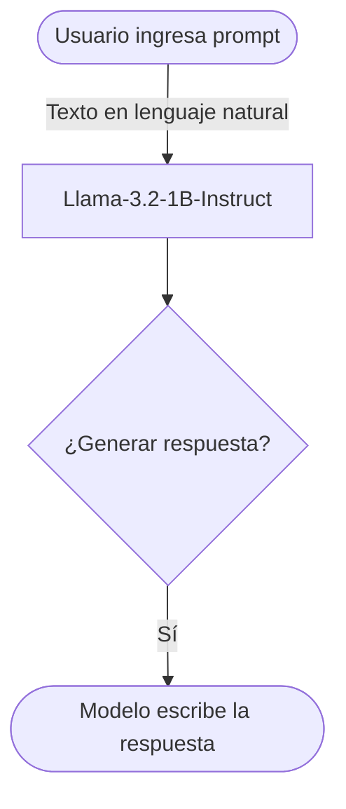

##  Datos del Modelo

| Especificación | Detalle |
| :--- | :--- |
| **Nombre del Modelo** | [Llama-3.2-1B-Instruct](https://huggingface.co) |
| **Desarrollador** | Meta |
| **Número de Parámetros** | 1.23 Billones ($1.23 \times 10^9$) |
| **Tipo de Tensor** | BF16 (bfloat16) |

##  Cálculo de Memoria VRAM

Para almacenar los pesos del modelo en memoria con una precisión de 16 bits (2 bytes por parámetro), se utiliza la siguiente ecuación matemática:

$$
\text{Memoria mínima (VRAM)} = P \times B
$$

Donde:
*   $P$ es el número total de parámetros del modelo ($1.23 \times 10^9$).
*   $B$ son los bytes requeridos por parámetro (2 bytes para BF16).

$$
\text{Memoria VRAM} = 1.23 \times 10^9 \times 2 \text{ bytes} \approx 2.46 \text{ GB}
$$

> **Nota:** Este cálculo representa únicamente el almacenamiento de los pesos fijos del modelo. La inferencia real requiere VRAM adicional para el contexto y los activations de la sesión de chat.

## 🖼️ Model Card de Hugging Face

## 🔀 Cómo funciona

